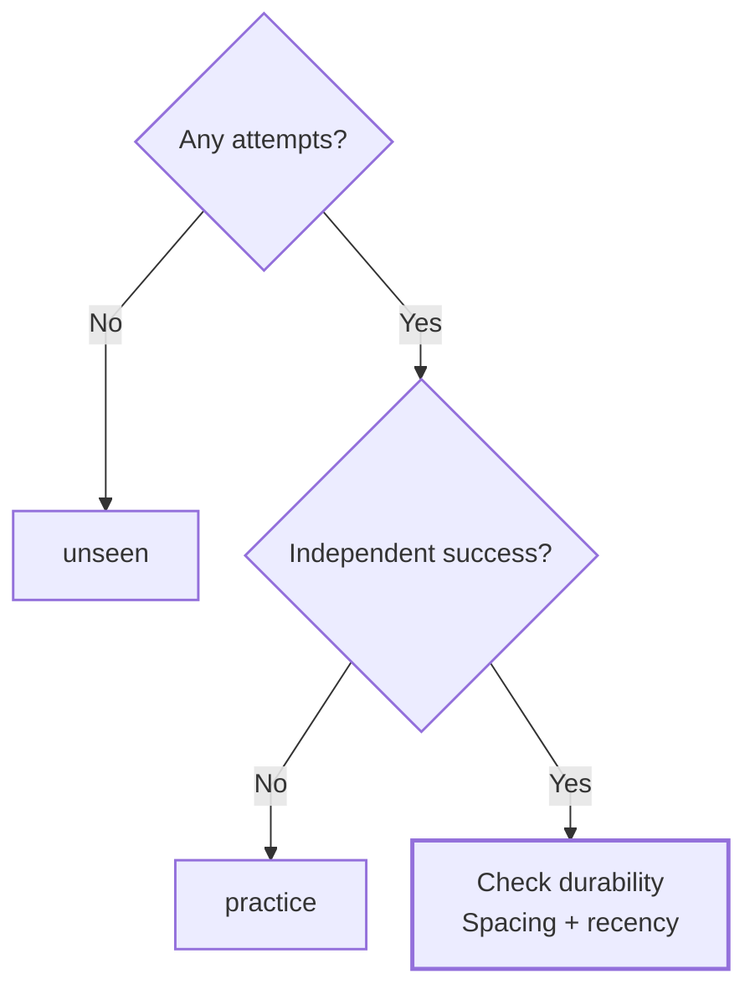
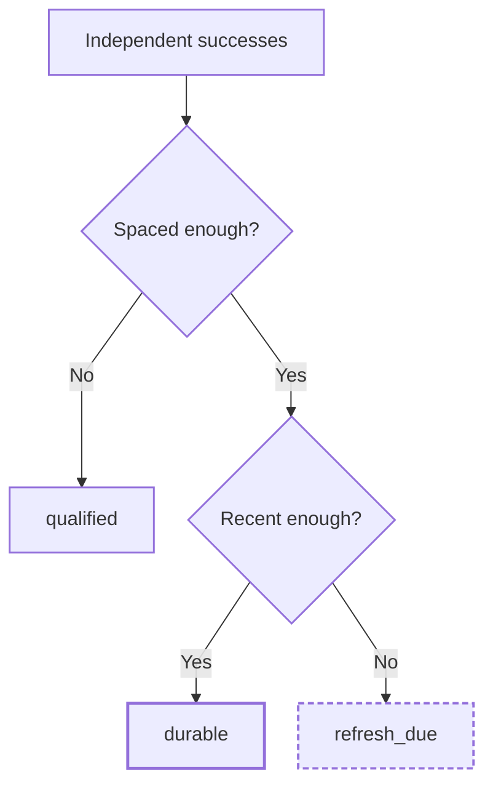

# Learning Evidence Core

If somebody walks me through an exercise and I finish it, have I learned it?

Maybe. But I definitely shouldn't get the same credit as finishing it alone.

This Python module keeps those two kinds of evidence separate. It reads attempts for one skill and figures out whether the learner is at **practice**, **qualified**, **durable**, or **refresh due**. No attempt at all is `unseen`.

## What counts?

Imagine a learner gets a problem right:

- With help: useful practice, **not** independent evidence.
- Alone, once: `qualified`.
- Alone, again after enough spacing: potentially `durable`.
- Not independently revisited for long enough: `refresh_due`.

The default policy asks for two independent successes at least a day apart, then checks a 30-day refresh window. These are **configurable software defaults**, not a secret scientific formula for the human brain. (I looked; no universally approved "learn Python in exactly 48 hours" constant exists in this code.)

Later independent success can refresh the recency clock. Assistance on one skill can't mysteriously make a different skill mastered.

## What the evidence actually earns

First decide whether an attempt was independent evidence or just practice.

Then decide if those independent successes are far enough apart, and recent enough, to count as durable.

Useful files: [mastery rules](src/learning_evidence/mastery.py), [evidence classification](src/learning_evidence/evidence.py), [models](src/learning_evidence/models.py), and [tests](tests/).

This is the rule engine, not a learning app with lessons, login, or saved student histories. The private Learning OS project contains broader work; none of that is silently bundled here. [Verification](docs/verification.md) · [provenance](PROVENANCE.md).
